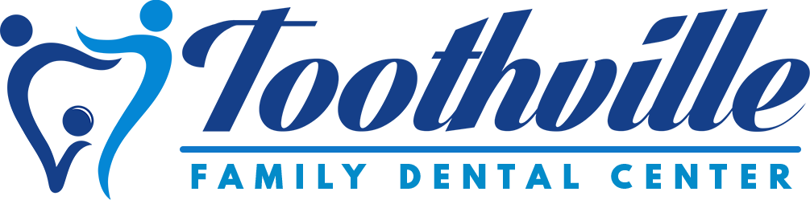

<a id="readme-top"></a>

<div align="center">
  

  <h3 align="center">Toothville Family Dental Software</h3>

  <p align="center">
    Patient records, intake forms, dental charts and treatment notes for a small dental clinic.
  </p>
</div>

## Contents

- [What it does](#what-it-does)
- [Tech stack](#tech-stack)
- [Project structure](#project-structure)
- [Getting started](#getting-started)
- [First-time database setup](#first-time-database-setup)
- [Data model](#data-model)
- [API reference](#api-reference)
- [Deployment](#deployment)
- [Known issues](#known-issues)

## What it does

The app has two kinds of users:

**Clinic staff (dentists / secretaries)** sign in and can:

- See a dashboard with total patients, patients added in the last week, and total earnings.
- Browse and search the patient list, and view or edit each patient's record.
- Edit a patient's medical history and intake form details.
- Use an interactive **dental chart** (FDI numbering, permanent and temporary teeth, five surfaces per tooth).
- Write dated **treatment notes** and attach procedures from the price list.
- Manage the **procedure price list** (name, category, price).
- Show a **QR code** (`/form-qr`) that patients scan to open the intake form.

**Patients** open the intake form (`/form`), enter the clinic's shared form password, and fill in a multi-step form:
personal info → contact info → emergency contacts → medical history (3 steps) → main concern + signatures.
Submitting creates a new patient record with a blank dental chart.

## Tech stack

| Area | Library |
| --- | --- |
| Framework | [Next.js 14](https://nextjs.org/) (App Router, route handlers for the API) |
| UI | React 18, Tailwind CSS, Radix UI / shadcn-style components, Heroicons, lucide-react |
| Forms | react-hook-form, zod, react-signature-canvas |
| Charts | Recharts |
| Database | MongoDB via [Mongoose](https://mongoosejs.com/) |
| Auth | bcryptjs password hashing, JWT in an HTTP-only cookie |

## Project structure

```
toothville/                    # the Next.js app (run all npm commands here)
├── public/assets/             # logos, backgrounds, banner
└── src/
    ├── middleware.js          # cookie checks for staff pages and patient form pages
    ├── models/User.js         # staff user model
    ├── utils/
    │   ├── db.js              # Mongo connection used by auth routes
    │   └── constants.js       # BASE_URL from NEXT_PUBLIC_BASE_URL
    ├── components/            # shared UI components (buttons, dialogs, signature modal, …)
    └── app/
        ├── page.jsx           # staff sign-in
        ├── (auth)/signup/     # staff sign-up (needs the clinic code)
        ├── dashboard/         # summary stats
        ├── home/              # staff area: patients, procedures, per-patient pages
        │   └── patients/[id]/ # summary, history, forms, dental-chart, notes
        ├── form/              # patient intake form (password protected)
        ├── form-qr/           # QR code linking to the intake form
        ├── lib/db.js          # Mongo connection + patient/notes/procedure/password models
        └── api/               # REST-style route handlers (see below)
```

## Getting started

### Prerequisites

- [Node.js](https://nodejs.org/) 18.17 or newer (required by Next.js 14) and npm
- A MongoDB database — either a free [MongoDB Atlas](https://www.mongodb.com/atlas) cluster or a local `mongod`

### 1. Install dependencies

```bash
cd toothville
npm install
```

All dependencies are listed in `package.json`, so there's no need to install packages one by one.

### 2. Create `toothville/.env.local`

```env
# MongoDB connection string. For Atlas, copy it from Connect → Drivers and add a database name.
MONGODB_URI=mongodb+srv://<user>:<password>@<cluster>.mongodb.net/toothville?retryWrites=true&w=majority

# Any long random string. Used to sign login and form cookies.
# Generate one with: node -e "console.log(require('crypto').randomBytes(48).toString('hex'))"
JWT_SECRET=change-me

# Where the app is served. The frontend calls the API at this address.
NEXT_PUBLIC_BASE_URL=http://localhost:3000
```

`.env` and `.env*.local` are git-ignored. Never commit real credentials.

If you use Atlas, also add your IP address (or `0.0.0.0/0` for hosted deployments) under **Network Access**, and create a database user under **Database Access**.

### 3. Run it

```bash
npm run dev
```

Open <http://localhost:3000>. Other scripts: `npm run build`, `npm start`, `npm run lint`.

## First-time database setup

Collections are created automatically on first write, but two settings have no screen in the app yet and must be added by hand on a new database:

| Collection | What it is | Needed for |
| --- | --- | --- |
| `appcodes` | One document `{ code: <bcrypt hash> }` — the clinic code | Staff sign-up. Sign-up crashes if this is missing. |
| `formpasswords` | One document `{ name: "password", password: <bcrypt hash> }` | Patients unlocking the intake form |

**Step 1 — make the hashes** (run inside `toothville/` after `npm install`):

```bash
node -e "console.log(require('bcryptjs').hashSync(process.argv[1], 12))" "YOUR-CLINIC-CODE"
```

```bash
node -e "console.log(require('bcryptjs').hashSync(process.argv[1], 12))" "YOUR-FORM-PASSWORD"
```

**Step 2 — insert them.** In Atlas, open **Browse Collections** → your database → **Create Collection / Insert Document**, or use `mongosh`:

```js
db.appcodes.insertOne({ code: "<hash of clinic code>" })
db.formpasswords.insertOne({ name: "password", password: "<hash of form password>" })
```

(The form password can also be set by sending `POST /api/formPassword-create` with `{ "newPassword": "..." }`.)

**Step 3** — go to `/signup`, create a staff account using the clinic code, then sign in.

## Data model

Defined in `src/app/lib/db.js` and `src/models/User.js`. Mongoose lowercases and pluralises collection names.

| Model | Collection | Contents |
| --- | --- | --- |
| `User` | `users` | `username` (unique), `password` (bcrypt), timestamps |
| `patient` | `patients` | Personal and contact info, emergency contact, family doctor, specialist, pharmacy, ID numbers, insurance, medical history (incl. allergies), concern, dentist, signatures (base64 images), `dateRecorded`, and `dentalChart` with four quadrants (`Upper_Right`, `Upper_Left`, `Lower_Right`, `Lower_Left`) of tooth objects |
| `patientNote` | `patientnotes` | `patientID` (string id of a patient), `date`, `comment`, and a copy of the `procedures` performed (name, price, category) |
| `procedure` | `procedures` | Price list: `name`, `category`, `price` |
| `formPassword` | `formpasswords` | Hashed patient-form password |
| `appCode` | `appcodes` | Hashed clinic sign-up code |

Each quadrant of the dental chart holds 13 teeth: 8 permanent and 5 temporary (e.g. Upper Right = 55–51 then 18–11). Each tooth stores the status of its `top`, `bottom`, `left`, `right` and `mid` surfaces (default `"Normal"`), plus `type` and `toothNum`.

## API reference

All routes live under `src/app/api/`. IDs are passed as a `?_id=` query parameter.

| Route | Methods | Purpose |
| --- | --- | --- |
| `/api/auth/signup` | POST | Create staff user (`username`, `password`, `inputCode`) |
| `/api/auth/signin` | POST | Sign in; sets `token` cookie (1 hour) |
| `/api/patient-record` | GET, POST, PUT, DELETE | List / create / update / delete patients |
| `/api/patient-find` | GET | One patient by id |
| `/api/forms` | GET, PUT | Read / update a patient's intake form fields |
| `/api/medical-history` | GET, PUT | Read / replace a patient's medical history |
| `/api/dental-chart` | GET, PUT | Read chart / update one tooth (`area`, `toothIdx`, `updatedTooth`) |
| `/api/notes` | GET, POST, PUT, DELETE | Treatment notes (`GET ?patientID=`) |
| `/api/notes-procedures` | PUT | Replace the procedures on a note |
| `/api/all-notes` | GET | Sum of all procedure prices across notes |
| `/api/procedure` | GET, POST, PUT, DELETE | Procedure price list |
| `/api/dashboard` | GET | Total patients, new this week, total earnings |
| `/api/formPassword` | POST | Check patient-form password; sets `token_forms` cookie |
| `/api/formPassword-create` | POST | Set / change the patient-form password |
| `/api/appCode` | POST, PUT | Set / check the clinic sign-up code |

## Deployment

The app deploys to any Node host; [Vercel](https://vercel.com/) is the simplest for Next.js:

1. Import the repo and set the **root directory** to `toothville`.
2. Add `MONGODB_URI`, `JWT_SECRET` and `NEXT_PUBLIC_BASE_URL` (your deployed URL, e.g. `https://toothville.vercel.app`) as environment variables.
3. In Atlas Network Access, allow connections from the host (Vercel uses dynamic IPs, so this usually means `0.0.0.0/0` with a strong database password).

## Known issues

Worth fixing before using this with real patient data:

- **API routes are not protected.** `middleware.js` only guards pages, not `/api/*`, so anyone who can reach the server can read or change patient records and reset the form password / clinic code. Each API route (or the middleware matcher) should verify the `token` cookie.
- **`POST /api/appCode` fails on an empty database** — it calls `.save()` on a plain object instead of a model instance. Use the manual setup above until it's fixed.
- **Dashboard "new this week"** builds its start date with `getDay()` (day of the week) instead of `getDate()` (day of the month), so the count is wrong.
- `patient-record` `PUT` updates old field names (`name`, `age`, `mobile`, …) that no longer exist in the schema; `/api/forms` `PUT` is the working update path.
- There are two separate Mongo connection helpers (`src/utils/db.js` and `src/app/lib/db.js`); they share a cache, but could be merged.

<p align="right">(<a href="#readme-top">back to top</a>)</p>
